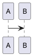
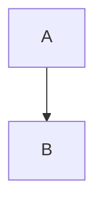

# kroki4tcl Guide — URL Encoding & Chunk Extraction

`kroki4tcl` is a Tcl reference implementation of the Kroki URL-encoding scheme: `base64(zlib(utf8(source)))` with URL-safe substitution (`+` → `-`, `/` → `_`, strip `=` padding). Source: `~/kroki4tcl/kroki4tcl/kroki4tcl.tcl:67-74`.

The Tcl implementation requires Tcl 8.6 with a patch that has not been applied on this host. Use the plugin's bash wrappers below instead — they implement the identical algorithm in Python via `python3 -c`.

## Wrappers

| Script | Purpose | Implementation |
|--------|---------|----------------|
| `~/kroki-claude-plugin/scripts/encode-url.sh` | Text → shareable kroki URL | `python3 -c 'zlib + base64'` |
| `~/kroki-claude-plugin/scripts/decode-url.sh` | Kroki URL → diagram source | `python3 -c 'base64 + zlib decompress'` |
| `~/kroki-claude-plugin/scripts/extract-chunks.sh` | Pull fenced diagram blocks from a `.md` file | `awk` |

## encode-url.sh

```bash
# From a file (type inferred from extension)
~/kroki-claude-plugin/scripts/encode-url.sh diagram.puml
# → http://localhost:8000/plantuml/svg/eNpLT...

# From stdin (type required)
echo 'A -> B' | ~/kroki-claude-plugin/scripts/encode-url.sh --type plantuml
# → http://localhost:8000/plantuml/svg/eNpL...

# Custom endpoint and format
~/kroki-claude-plugin/scripts/encode-url.sh diagram.d2 --endpoint https://kroki.io --format png
# → https://kroki.io/d2/png/eNpL...
```

Flags:

| Flag | Effect | Default |
|------|--------|---------|
| `--type <name>` | Diagram type. Required when reading from stdin. | Inferred from file extension. |
| `--format <fmt>` | Output format embedded in URL. | `svg` |
| `--endpoint <url>` | Kroki endpoint base URL. | `http://localhost:8000` |
| `--help`, `-h` | Print usage. | — |

Exit codes:

| Code | Meaning |
|------|---------|
| `0` | URL printed to stdout. |
| `2` | Bad input (missing type, file not found, etc.). |
| `3` | Usage error. |

## decode-url.sh

```bash
~/kroki-claude-plugin/scripts/decode-url.sh 'http://localhost:8000/plantuml/svg/eNpLT...'
# → @startuml
#   A -> B
#   @enduml
```

Decoded source goes to stdout. Pipe to a file to save:

```bash
~/kroki-claude-plugin/scripts/decode-url.sh '<url>' > recovered.puml
```

The script accepts both `http://` and `https://` URLs and any path shape that ends in a valid base64-url-safe string.

Exit codes:

| Code | Meaning |
|------|---------|
| `0` | Source printed to stdout. |
| `2` | URL malformed or decoding failed. |
| `3` | Usage error. |

## extract-chunks.sh

Extract every fenced diagram code block from a markdown file and write each to a separate file in an output directory.

```bash
# Default: output to ./extracted/, one file per chunk, named by chunk index + language
~/kroki-claude-plugin/scripts/extract-chunks.sh path/to/notes.md

# Custom output dir
~/kroki-claude-plugin/scripts/extract-chunks.sh notes.md --out /tmp/chunks
```

Recognized fence shapes (case-insensitive on the language tag):

````


```{.puml}
@startuml
...
@enduml
```


````

Output files:

| Pattern | Example |
|---------|---------|
| `<index>-<lang>.<ext>` | `01-plantuml.puml`, `02-mermaid.mmd`, `03-d2.d2` |

Where `<lang>` is normalized (e.g. `puml` → `plantuml`, `dot` → `graphviz`) and `<ext>` is the canonical extension.

Exit codes:

| Code | Meaning |
|------|---------|
| `0` | Chunks extracted (count printed to stderr). |
| `1` | No chunks found. |
| `2` | Input file not readable. |
| `3` | Usage error. |

## Why Python instead of Tcl

The reference implementation uses Tcl 8.6's `binary encode base64` and `zlib compress`. On this Jetson Orin host, the kroki4tcl Tcl package fails to load with the system Tcl (a known patch is needed but not applied). Python 3 ships with `zlib` and `base64` in the stdlib and is universally available. The wrappers do not depend on any third-party Python package.

## Upstream

- https://github.com/mittelmark/kroki4tcl
- Tcl source (algorithm reference): `~/kroki4tcl/kroki4tcl/kroki4tcl.tcl:67-74`
- Kroki URL spec: https://docs.kroki.io/kroki/setup/encode-diagram/
