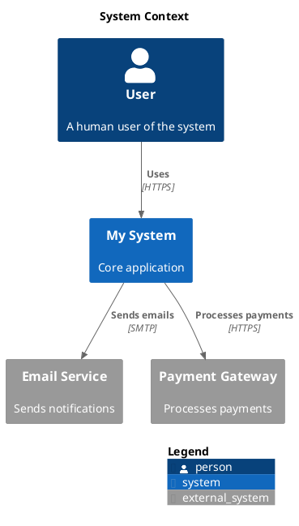
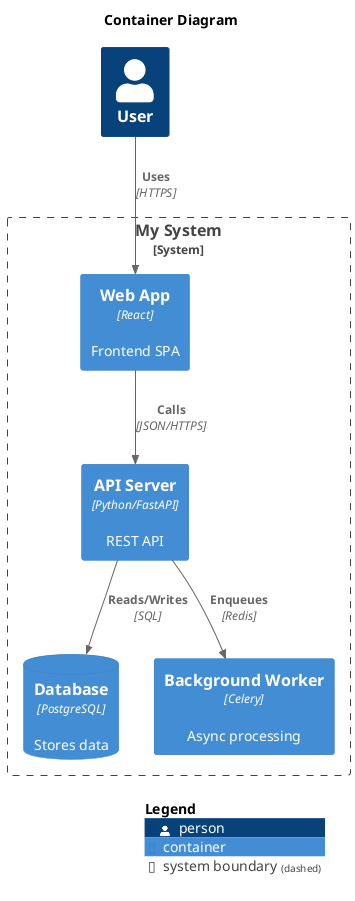
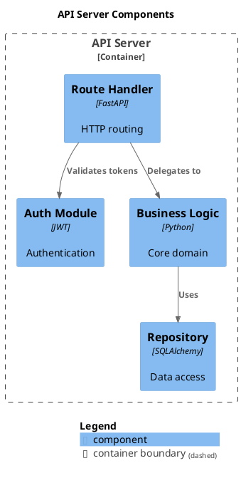

# C4-PlantUML Reference

C4-PlantUML implements the C4 model (Context, Container, Component, Code) for architecture diagrams. Industry standard for system architecture visualization. Has a native `LEGEND()` macro.

**Engine:** Core gateway (uses PlantUML engine with C4 library)
**File extensions:** `.puml` (same as PlantUML — distinguish by `!include <C4/...>`)
**Kroki type string:** `c4plantuml`

## Context Diagram (Level 1)



## Container Diagram (Level 2)



## Component Diagram (Level 3)



## Legend Support

**Native.** C4-PlantUML has built-in `SHOW_LEGEND()` and `LEGEND()` macros that auto-generate relationship and element type legends.

```plantuml
SHOW_LEGEND()
' or for custom:
LEGEND()
```

## Common Pitfalls

- Use Kroki type `c4plantuml` not `plantuml` — the C4 includes won't resolve with plain PlantUML
- `System_Boundary` is for Level 2 (containers); `Container_Boundary` is for Level 3 (components) — mixing them produces confusing output
- `Rel()` arrows go from left to right by default; use `Rel_L`, `Rel_R`, `Rel_U`, `Rel_D` for direction
- `SHOW_LEGEND()` must come after all `Rel()` calls to capture all relationship types

## Upstream Docs

- https://github.com/plantuml-stdlib/C4-PlantUML
- https://c4model.com/ (C4 model specification)
