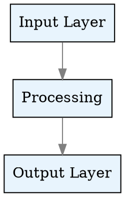
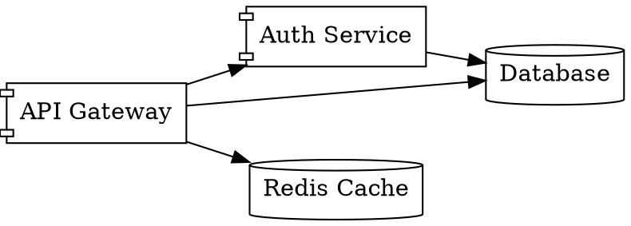
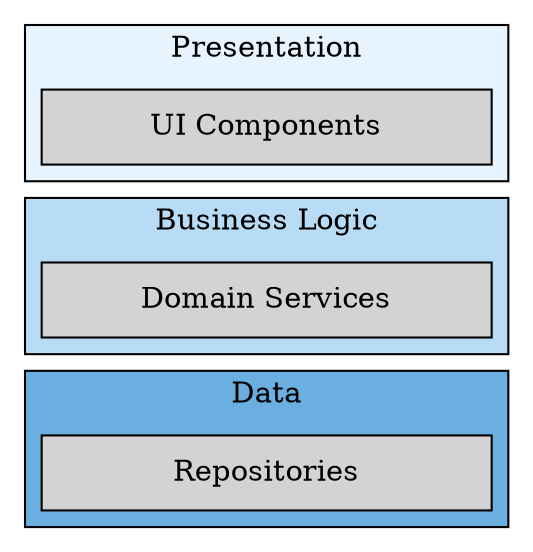

# Graphviz Reference

Graphviz excels at directed graphs, dependency trees, and layer diagrams. Its DOT language is concise and the layout engines (dot, neato, fdp, sfdp, circo, twopi) handle complex topologies automatically.

**Engine:** Core gateway (no companion container needed)
**File extensions:** `.dot`, `.gv`
**Kroki type string:** `graphviz`

## Directed Graph



## Dependency Graph



## Layered Architecture



## Legend Support

**Native for simple legends** (subgraph cluster with label). **Stitch for complex legends** with multiple sections.

```dot
subgraph cluster_legend {
    label="Legend"
    style=filled
    fillcolor=white
    node [shape=plaintext]
    l1 [label="Blue = Core"]
    l2 [label="Gray = External"]
}
```

## Common Pitfalls

- Missing `digraph` keyword (bare `{ a -> b }` is invalid)
- `rankdir=LR` vs `rankdir=TB` changes layout dramatically — pick deliberately
- HTML-like labels (`<table>`) must be wrapped in `<` `>` not quotes
- `subgraph` name MUST start with `cluster_` to get a bounding box
- Semicolons are optional but help readability in complex graphs

## Upstream Docs

- https://graphviz.org/documentation/
- https://graphviz.org/doc/info/lang.html (DOT language)
- https://graphviz.org/doc/info/attrs.html (attributes)
