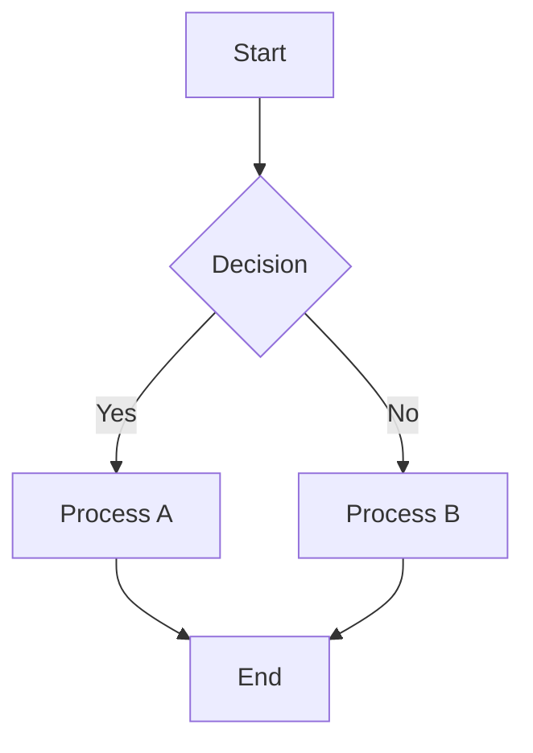
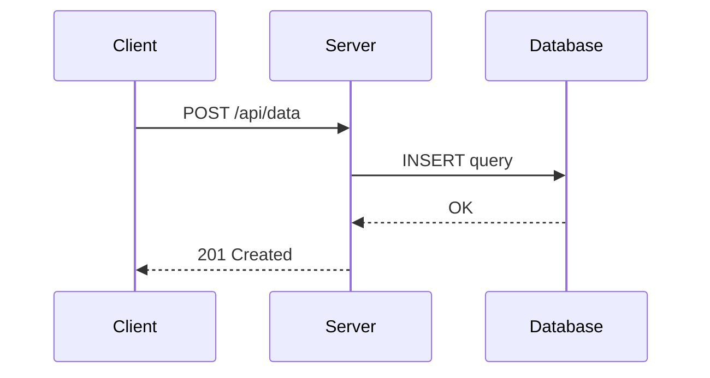
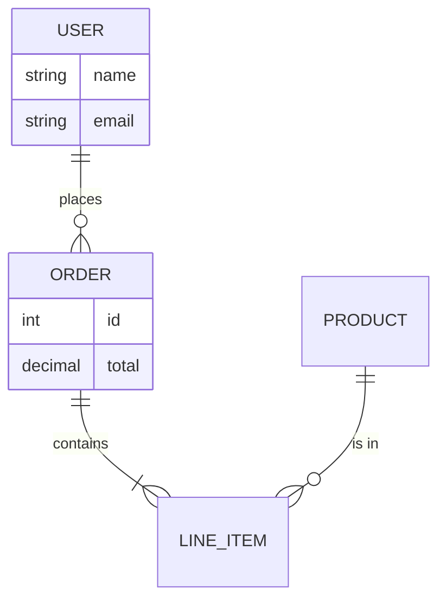
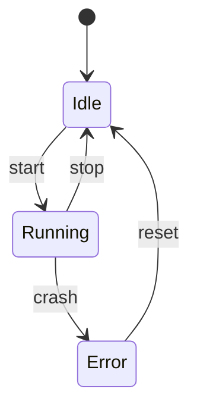

# Mermaid Reference

Mermaid is widely readable and renders natively in Obsidian (without Kroki) as a fenced code block. Best for flowcharts and decision logic. Use Kroki rendering when you need file output (SVG/PNG) or legend stitching.

**Engine:** Companion container (`kroki-mermaid`)
**File extensions:** `.mmd`, `.mermaid`
**Kroki type string:** `mermaid`

## Flowchart

## Sequence Diagram

## Entity-Relationship

## State Diagram

## Legend Support

**Stitch required.** Mermaid has no native legend syntax. Use the plugin's stitch mode — a separate legend SVG is composited alongside the diagram.

## Common Pitfalls

- `flowchart` (new) vs `graph` (deprecated) — always use `flowchart`
- Arrow syntax: `-->` (solid), `-.->` (dotted), `==>` (thick) — mistyped arrows silently parse as text
- Node IDs cannot start with a number or contain spaces without brackets
- `stateDiagram-v2` (use v2) vs `stateDiagram` (v1, fewer features)
- Obsidian renders mermaid natively in code fences — Kroki only needed for file output

## Upstream Docs

- https://mermaid.js.org/
- https://mermaid.js.org/syntax/flowchart.html
- https://mermaid.js.org/syntax/sequenceDiagram.html
- https://mermaid.js.org/syntax/entityRelationshipDiagram.html
