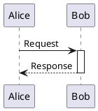
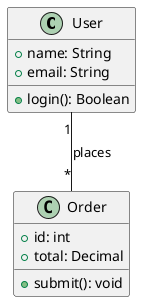
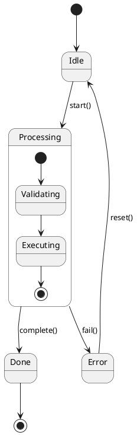
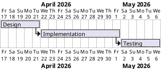

# PlantUML Reference

PlantUML is the most versatile Kroki language — supports sequence, class, state, activity, component, use case, object, deployment, timing, Gantt, WBS, mindmap, and JSON/YAML diagrams. It's the default choice for most UML and PM diagram types.

**Engine:** Core gateway (no companion container needed)
**File extensions:** `.puml`, `.plantuml`, `.pu`
**Kroki type string:** `plantuml`

## Sequence Diagram



## Class Diagram



## State Diagram



## Gantt Chart



## Legend Support

**Native.** PlantUML supports inline legends:

```plantuml
legend right
  |= Color |= Meaning |
  |<#0072B2> | Core subsystem |
  |<#56B4E9> | External system |
  |<#D55E00> | Error path |
endlegend
```

## Common Pitfalls

- Missing `@startuml` / `@enduml` wrappers causes silent failure
- C4 macros (`!include <C4/C4_Context>`) require the C4-PlantUML library bundled in Kroki — use `c4plantuml` type instead of `plantuml` for C4 diagrams
- Gantt `lasts N days` must use integer — no fractional days
- `skinparam` must come before any diagram elements

## Upstream Docs

- https://plantuml.com/
- https://plantuml.com/sequence-diagram (sequence)
- https://plantuml.com/class-diagram (class)
- https://plantuml.com/state-diagram (state)
- https://plantuml.com/gantt-diagram (gantt)
